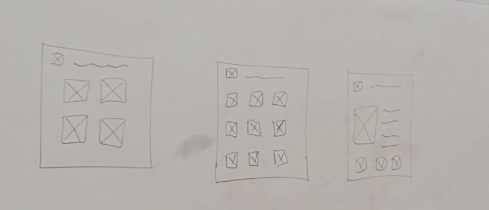

# Biblioteca Pokemon

Enciclopédia interativa de Pokémon, **em português**, que consome a [PokéAPI](https://pokeapi.co/) em tempo real.
Feita com HTML, CSS e JavaScript puros (sem frameworks), sobre o projeto base das aulas.

**Autor:** [bryantheconnor-art](https://github.com/bryantheconnor-art) · **Repositório:** [Site-dos-Pokemons](https://github.com/bryantheconnor-art/Site-dos-Pokemons)

> Pokémon e os nomes dos personagens são marcas registradas da Nintendo, Creatures Inc. e GAME FREAK inc.
> © Nintendo. Todos os direitos reservados. Projeto de fã, sem fins lucrativos e sem vínculo oficial com a Nintendo.

## Esboço

O layout segue o rascunho de três telas em [`docs/esboco-wireframe.png`](docs/esboco-wireframe.png):



| Tela do esboço | Página | O que mostra |
| --- | --- | --- |
| 1 — quatro cartões grandes | `#home` | **Banner grande com vários Pokémon reunidos**, busca rápida, autoria, Pokémon animado, perfil interativo do GitHub e Pokébola animada; mais 4 cartões 2 × 2 |
| 2 — grade de ícones (3 × 4) | `#pokedex` | 12 Pokémon por página; filtros recolhíveis (nome/número, tipo, região, favoritos) e paginação |
| 3 — imagem + texto + 3 ícones | `#pokemon/25` | Imagem grande, tipos, descrição, medidas e fileira de ícones da evolução; abaixo: atributos, fraquezas, habilidades e dados da espécie |
| — | `#sobre` | Autor, APIs, esboço, acessibilidade e aviso de direitos |

São **4 páginas**. `#tipos` e `#favoritos` levam à Pokédex já filtrada e `#aleatorio` sorteia um Pokémon.

## Inspiração

- **Pottermore**: tipografia com serifa, detalhes dourados e a descrição da Pokédex num "pergaminho".
- **Site de Genshin Impact**: banner com os personagens em destaque e cartões com brilho na cor do tipo (como os elementos).
- **Identidade visual**: fundo vermelho e azul-claro, com painéis pretos e detalhes em vermelho para manter o contraste e a leitura.

## APIs

Todas as chamadas à PokéAPI ficam em [`js/api.js`](js/api.js), com cache em memória:

| Endpoint | Uso |
| --- | --- |
| `/pokemon` | Lista de espécies; tipos, atributos, habilidades e imagens |
| `/pokemon-species` | Descrição, região, habitat, cor, gênero, captura e cadeia de evolução |
| `/evolution-chain` | Linha evolutiva |
| `/type` | Tipos, Pokémon de cada tipo e **tabela de fraquezas** (relações de dano combinadas) |
| `/generation` | Pokémon de cada região (filtro da Pokédex) |
| `/ability` | Descrição das habilidades |

Além da PokéAPI, a página usa a **MyMemory Translation API** para traduzir descrições e a **GitHub REST API** para apresentar os dados públicos do perfil do autor. As três estão destacadas também na página inicial.

**Português:** a PokéAPI não traz textos em português. Por isso:

- tipos, atributos, regiões, habitats, cores, grupos de ovos e crescimento têm tabelas próprias em [`js/ui.js`](js/ui.js);
- as descrições (Pokédex e habilidades) são traduzidas pela **segunda API**, a [MyMemory](https://mymemory.translated.net/), em [`js/traducao.js`](js/traducao.js). O resultado fica guardado no navegador e, se a tradução falhar, o texto aparece em inglês com um aviso. É tradução automática e pode errar;
- nomes de Pokémon e de habilidades ficam como na API.

Os dados entram na página sempre como texto (nunca `innerHTML`). Falhas de rede mostram uma mensagem com o botão "Tentar novamente".
O cartão do GitHub consulta a API pública do GitHub e mostra uma ação para tentar novamente quando a consulta falha. A página inicial também oferece busca rápida, animação de Pikachu pausável e Pokébola interativa.

## Acessibilidade

- Link "Pular para o conteúdo", navegação por teclado e foco visível;
- landmarks (`header`, `nav`, `main`, `footer`), um `h1` por página e título da aba atualizado a cada rota;
- foco movido para o título ao trocar de página e avisos (`aria-live`) para carregamento e favoritos;
- tipos identificados por texto (não só por cor), contraste ≥ 4,5:1 nos selos de tipo;
- textos alternativos nas imagens, `prefers-reduced-motion` respeitado e layout responsivo.

## Como executar

Não há etapa de build. Abra `index.html` no navegador ou sirva a pasta:

```bash
python3 -m http.server 8080
# http://localhost:8080
```

## Estrutura

```
index.html          estrutura, cabeçalho, navegação e rodapé (com comentários)
style.css           tema
app.js              roteador por hash
js/config.js        nome do site e do autor
js/api.js           cliente da PokéAPI
js/traducao.js      tradução automática (MyMemory)
js/ui.js            helpers de DOM, tabelas em português e favoritos
js/pages/*.js       uma página por arquivo (home, pokedex, detalhe, sobre)
assets/             logo e favicon (originais)
docs/               esboço do projeto e guia de Git
```

## Git

Veja [`docs/GUIA-GIT.md`](docs/GUIA-GIT.md): como dar **commit**, **merge** (Pull Request) e **fork** neste repositório.
